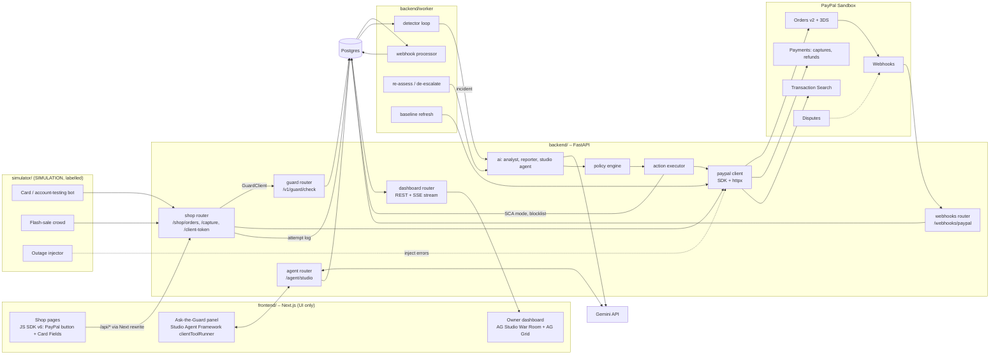

# 02 · Architecture

## 1. Shape of the system [R]
There are two separately deployed apps plus a worker. **Status** says what the code does today (**built**) and what is still only a plan (**planned**); the [top-level README](../README.md) describes the built system.

| Part | Tech | Job | Status |
|---|---|---|---|
| **frontend/** | Next.js 16 (App Router) + TypeScript + Tailwind, AG Grid + AG Charts (Community), PayPal JS SDK v6 | **UI only:** the demo shop "Wick & Wax" and the owner dashboard (War Room, incidents, reports, settings, Demo lab). No PayPal secrets, no business logic | **Built** with the PayPal button (wallet). **Planned:** Card Fields in the shop, AG Studio |
| **backend/** (API) | Python 3.12, FastAPI, Pydantic v2, SQLAlchemy 2 (async) + Alembic, httpx, Google Gen AI SDK (`google-genai`) | Shop order API, guard check (also public as `POST /v1/guard/check`), webhooks, PayPal client, AI analyst, policy engine, action executor, reports, dashboard API + live stream (Postgres LISTEN/NOTIFY → SSE) | **Built.** **Planned:** Studio agent endpoint |
| **backend/worker** | Same Python package, separate process (`python -m app.worker.main`) | Webhook processing, detector loop, incident re-assessment, de-escalation, device-block expiry, in-flight refund sweeper, heartbeat | **Built.** The baseline comes from the shop's own attempts (seeded history in the demo). **Planned:** baseline refresh from Transaction Search |
| **Simulator** | Inside the backend (`app/simulator/`), driven from the Demo lab, `/demo/*` and `scripts/attack.py` (Typer) | Labelled attacker and control scenarios: card testing, account testing, slow drip, flash sale, outage, normal night | **Built** (offline, and live sandbox for card scenarios) |
| **Evaluation** | `scripts/eval_ai.py` + the pytest suite | Scores the live analyst on attack vs rush vs outage; the tests replay the pipeline end to end with PayPal and Gemini mocked | **Built** |
| Postgres | Render Postgres (paid) | The single store; no Redis | **Built** (docker compose locally, `render.yaml` for Render) |

**Why a separate Python backend:**
- It keeps the product (the guard) apart from the UI.
- It makes the guard reusable by any shop: a later WooCommerce plugin would call the same `/guard/check`.
- It matches the AI/data work, done with Pydantic models and good test tooling.
- The frontend stays a thin client that is easy to polish.

**Inside the backend there are two bounded parts:**
- `shop` is the demo merchant's server.
- `guard` is our product.

`shop` reaches `guard` only through a `GuardClient` interface. In-process for the MVP, `GuardClient` is the same contract the public `POST /v1/guard/check` HTTP endpoint exposes. So the boundary is real even though both run in one deployable.

## 2. Component diagram



## 3. Key flows

### 3.1 Checkout attempt (hot path, target < 150 ms added latency)
1. The shop page (or the bot) calls `POST /shop/orders` with the cart and checkout context: fingerprint hash, email, method.
2. The `shop` router calls `GuardClient.check(context)`. The guard reads the **cached guard state** (mode, blocklist, SKU holds; in-memory with a 2 s TTL, backed by Postgres) and returns one of:
   - `allow`
   - `allow_with_sca`
   - `challenge`
   - `block`
3. On `allow_with_sca`, the shop sets `payment_source.card.attributes.verification.method = "SCA_ALWAYS"` on the order (Web). On `block` or `challenge`, it returns 403/428 to the browser.
4. The shop creates and captures through PayPal, then writes a `checkout_attempts` row with the outcome and decline code.
   - **Our own logs are the main signal**, because decline webhooks are unconfirmed (Web).

### 3.2 Webhook
`POST /webhooks/paypal` reads the raw body, verifies it, stores it in `paypal_events` (deduplicated on transmission ID) and returns 200 fast. The worker processes it later: updates the capture or refund state and links disputes.

### 3.3 Incident lifecycle
1. The detector runs every 10 s and computes window features against the baseline.
2. A trigger opens an `incident`.
3. The AI analyst returns a verdict.
4. The policy engine decides the allowed actions and the executor runs them:
   - guard-state change (SCA, block fingerprints, hold SKU)
   - refunds through PayPal
   - notify
5. The reporter writes the alert.
6. Re-assessment runs every 5 min.
7. After N quiet minutes, de-escalation runs and the reporter writes the morning report and evidence pack.

### 3.4 Live dashboard
The frontend subscribes to `GET /dashboard/stream` (SSE) for attempts, incidents and actions, and loads datasets into AG Studio through REST.

## 4. Repo layout (target)
```
checkout-guard/
  frontend/                 Next.js (moved from current scaffold)
    src/app/(shop)/...      shop pages
    src/app/dashboard/...   War Room, incidents, reports, settings
    src/lib/api.ts          typed client generated from backend OpenAPI
  backend/
    pyproject.toml          uv-managed
    app/
      main.py               FastAPI app, routers, CORS, lifespan
      config.py             pydantic-settings
      db/                   models.py, session.py, migrations/ (Alembic)
      api/                  shop.py, guard.py, webhooks.py, dashboard.py, agent.py, settings.py, auth.py
      paypal/               client.py (token cache), orders.py, payments.py, webhooks.py, reporting.py, disputes.py
      guard/                state.py (cache), check.py
      detection/            features.py, baseline.py, triggers.py
      ai/                   analyst.py, reporter.py, studio_agent.py, prompts/, schemas.py
      policy/               engine.py, rules.py
      actions/              executor.py
      reports/              render.py (Markdown/PDF)
      observability/        logging.py (structlog), audit.py
    worker/main.py          scheduler entrypoint
    tests/
  simulator/                Typer CLI + scenario definitions
  eval/                     scenarios/, fixtures/, run.py, report.md
  docs/
  render.yaml
  docker-compose.yml        postgres + backend + worker + frontend
  LICENSE (MIT)
```

## 5. Tech choices (backend)
| Concern | Choice | Notes |
|---|---|---|
| Packaging | **uv**, Python 3.12 | Fast, lockfile |
| Web | FastAPI + Uvicorn | OpenAPI → typed TS client for the frontend (`openapi-typescript`) |
| Models | Pydantic v2 | Also used as the JSON schema for Gemini structured output |
| DB | SQLAlchemy 2 async + asyncpg, Alembic | Postgres only |
| PayPal | Official Python **`paypal-server-sdk`** for Orders/Payments; **httpx** for Webhooks verify, Transaction Search, Disputes | Confirm which SDK version covers which endpoints in P1. Using the SDK also gives the APIMatic Context Plugin a real job |
| AI | `google-genai` SDK (Gemini) | Structured output via `response_schema` (Pydantic) |
| Scheduling | APScheduler in the worker process | Single instance, held by a Postgres advisory lock |
| Live updates | `sse-starlette` | Simpler than websockets |
| Logging | structlog (JSON) + `audit_log` table | |
| Tests | pytest, pytest-asyncio, respx (mock httpx), Hypothesis for detector edge cases | |
| Lint/type | Ruff, mypy (strict on `policy/`, `guard/`) | |

## 6. Deployment (Render)
| Service | Type | Plan [R] |
|---|---|---|
| `cg-backend` | Web Service (Docker/Python) | Paid starter. Must not spin down during judging |
| `cg-worker` | Background Worker | Paid starter (no free tier for workers (Web)) |
| `cg-frontend` | Web Service (Node) | Paid starter, or free if acceptable cold starts (no; judges see the delay) |
| `cg-db` | Postgres | Paid (free expires after 30 days (Web)) |

- **Budget:** check the cost against the $50 Render credits in P0 and top up if needed. The demo must survive to Dec 15 (R12).
- **Render Workflows:** optional, not in the MVP (beta-era, compute billing (Web)).
- **Frontend → backend:** a Next.js `rewrites()` proxy maps `/api/*` → `cg-backend`, so the browser deals with a single origin, with no CORS or cookie problems.

## 7. Security & responsible AI
- **Secrets:**
  - PayPal client secret, Gemini API key and AG license live only in Render env vars, read by `pydantic-settings`.
  - The frontend gets only the PayPal **client token** (`/shop/client-token`) and the AG license key it needs.
  - gitleaks runs as a pre-commit hook.
- **Auth:**
  - The dashboard and settings sit behind a demo login. JWT goes in an httpOnly cookie, and the judge credentials are in the README.
  - `/v1/guard/check` (the external form) needs a per-shop API key.
  - The simulator endpoints are enabled only when `SIMULATOR_ENABLED=true`, and every attempt they create is tagged `source=simulator`.
- **Webhooks:**
  - Verify every webhook, via postback in the MVP and offline CRC32 + cert self-check in P2 (Web).
  - Store unverified events but never act on them. Deduplicate on transmission ID.
- **Data minimisation for the LLM:** Gemini only ever sees aggregated features plus a few masked rows:
  - email *domain* only
  - hashed fingerprint and payer IDs
  - BIN country, not the card number
  - no names, addresses, tokens or credentials
- **AI never moves money:**
  - The verdict is advice. `policy/engine.py`, which is deterministic and unit-tested, decides.
  - Refund caps (per transaction and per incident) apply; above them the owner must approve. A kill switch exists.
  - Refunds only for captures that match the incident's deterministic signature.
- **Card data:**
  - Real checkouts use PayPal-hosted Card Fields, so card numbers never touch our servers.
  - Only the **simulator** sends *sandbox test* card numbers server-side, and the backend rejects that path unless the base URL contains `sandbox`.
- **False positives:**
  - Soft first (3DS), then challenge, then block.
  - The sale calendar suppresses blocking.
  - Auto de-escalation.
  - The flash-sale scenario is a required test.

## 8. Real vs simulated (state this in the README and video)
- **Real (sandbox) — built:**
  - PayPal OAuth, orders and captures (Orders v2), declines (`CCREJECT-*` triggers, live simulation mode), 3-D Secure (`SCA_ALWAYS`), refunds, webhooks with signature verification
  - Sandbox disputes: `CUSTOMER.DISPUTE.*` webhooks are handled (a disputed capture is never refunded automatically)
  - Gemini calls (analyst and report writer)
  - Render (Blueprint in `render.yaml`)
- **Real — planned, not built:**
  - Transaction Search (the baseline uses the shop's own attempts and seeded history)
  - The Disputes API (we only consume dispute webhooks)
  - PayPal Card Fields in the shop (card attempts come from the simulator)
  - AG Studio and the Studio agent (the dashboard uses AG Grid + AG Charts Community)
- **Simulated, labelled on screen (SIM badge, `source=simulator` / `seed`):**
  - the attacker
  - "stolen" credentials (sandbox test cards and synthetic buyers)
  - offline mode: no PayPal call, synthesised outcomes (`paypal_live=false`)
  - the outage scenario (injected errors)
  - seeded baseline history
  - the owner's phone on the War Room (a mock-up showing the real alert texts; `NOTIFY_WEBHOOK_URL` pushes them to Slack or ntfy for real)
